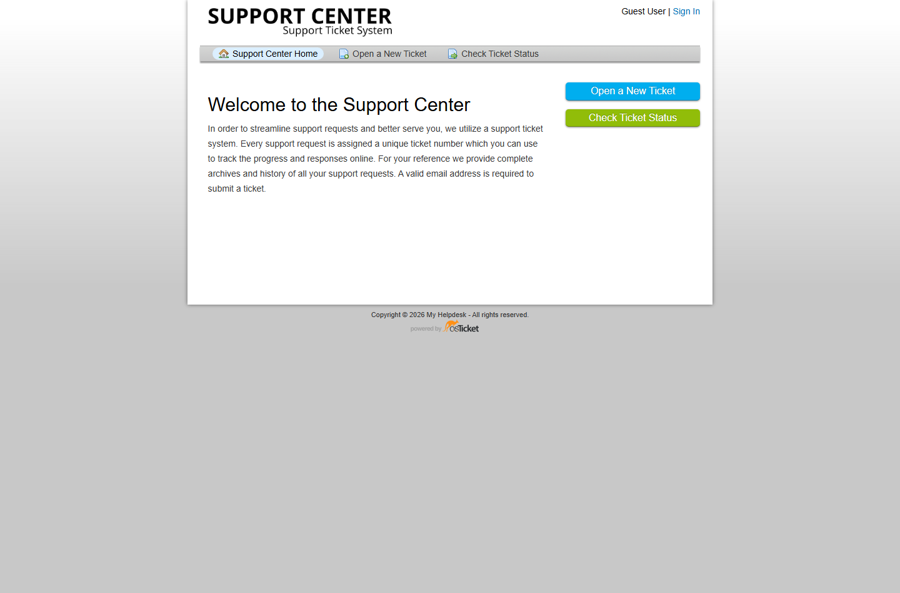
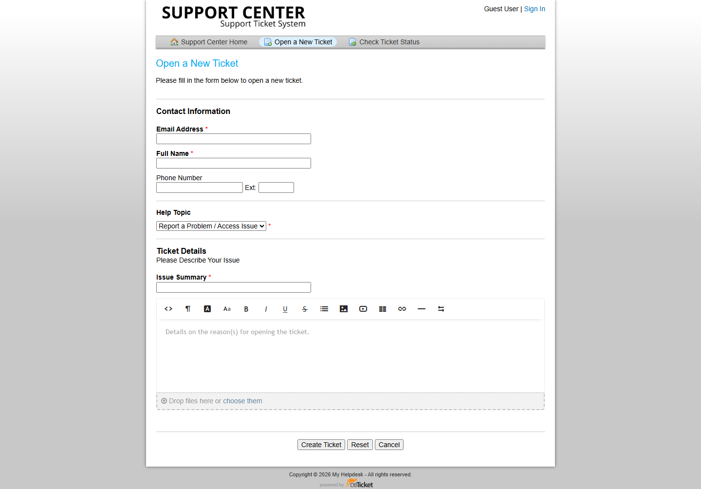
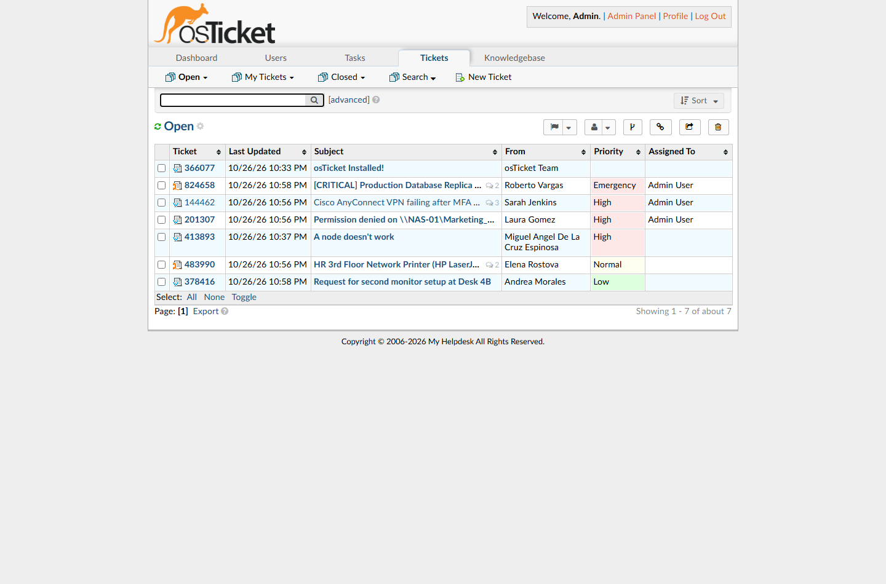
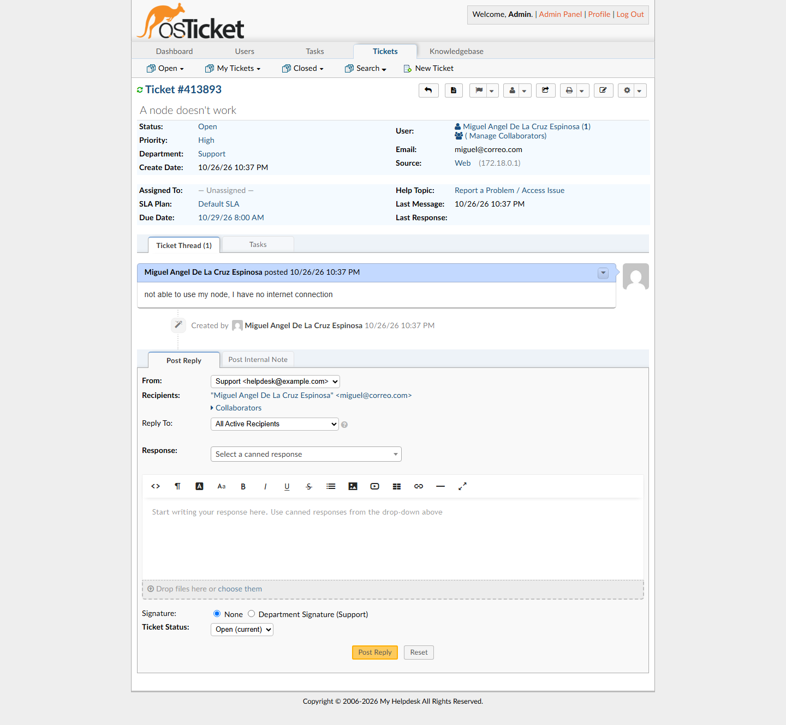
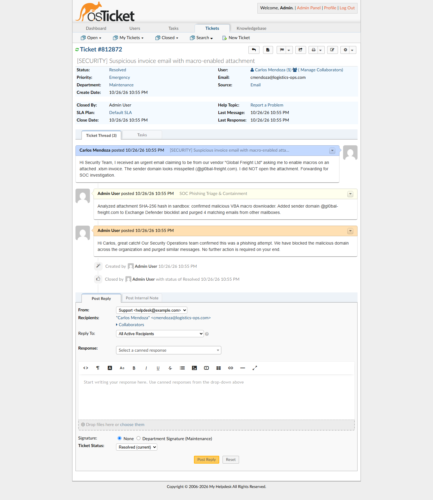
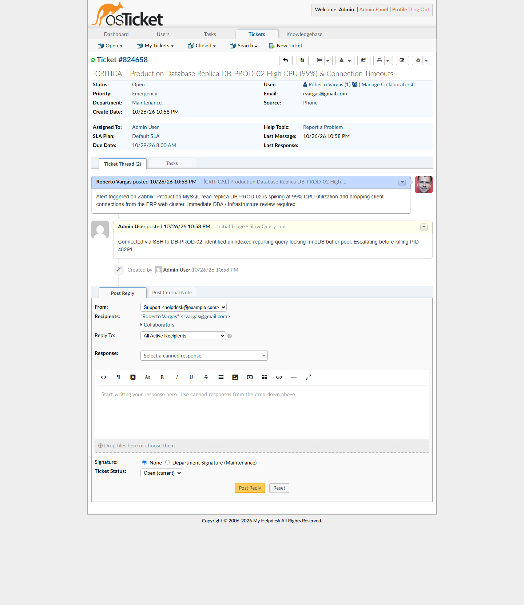
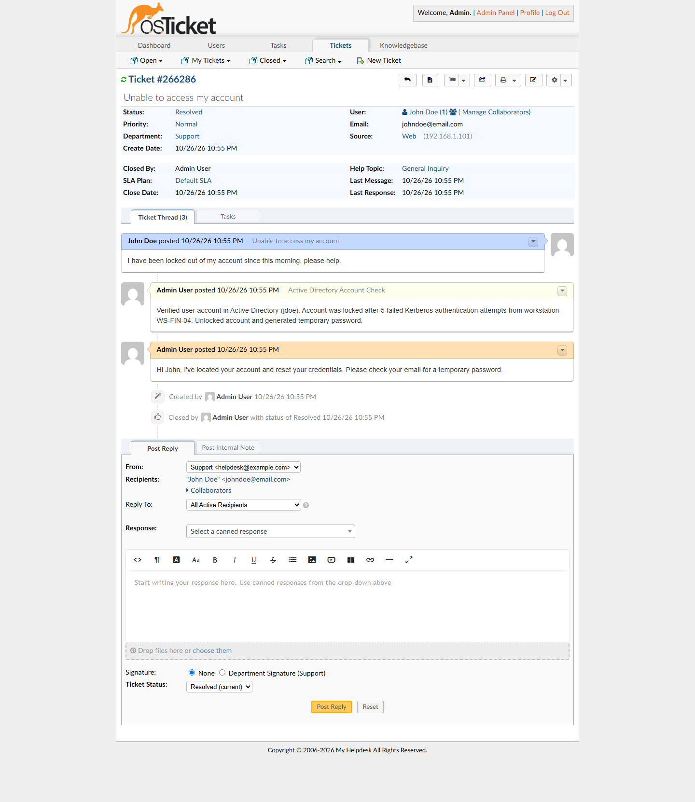
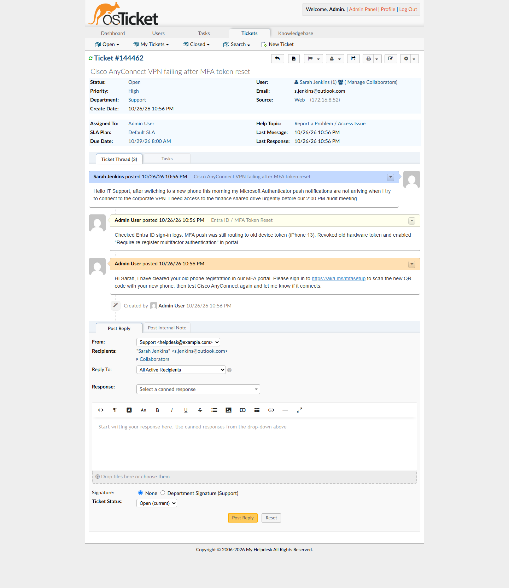
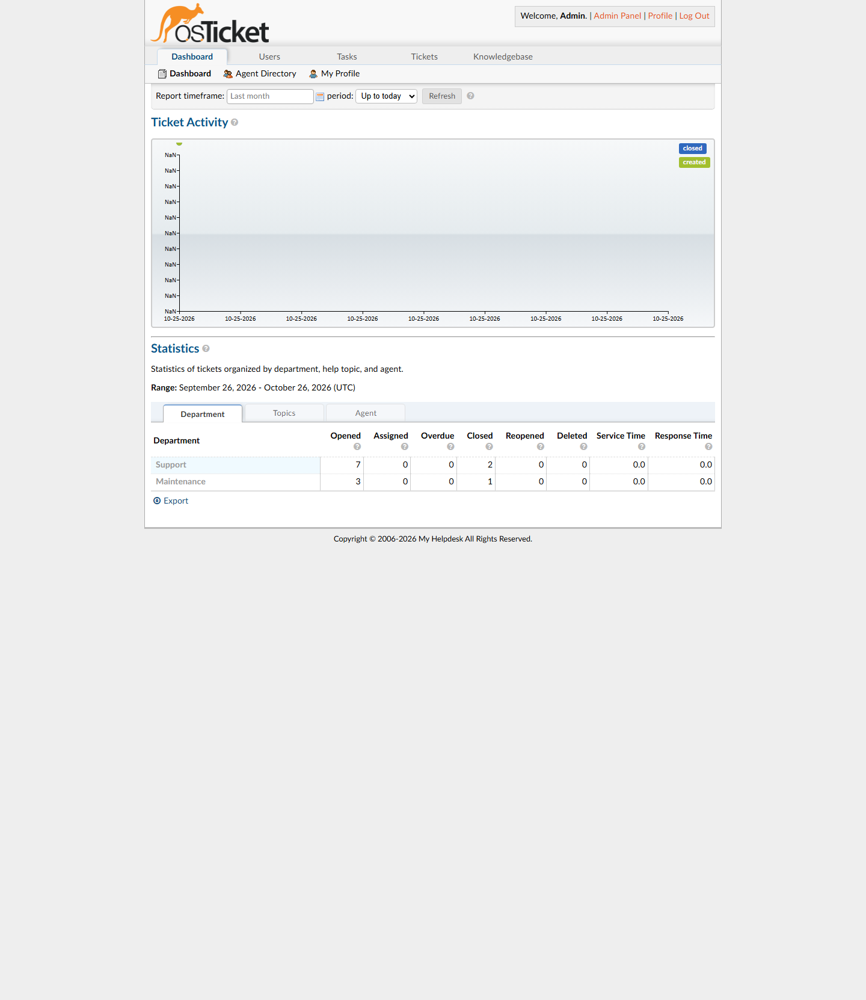
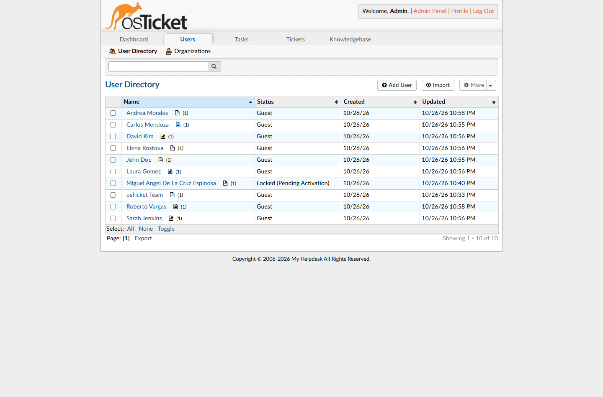

# 🎫 osTicket Help Desk & SOC Ticketing Lab (Docker + MySQL on Windows)

Despliegue contenedorizado de **osTicket** (sistema open-source de gestión de tickets de soporte TI / Help Desk) junto con **MySQL 5.7** utilizando **Docker Compose** en un entorno **Windows 11 + WSL 2**.

Este laboratorio demuestra la implementación de la infraestructura, resolución de errores reales de virtualización y despliegue, y la gestión completa del ciclo de vida de incidentes de **Soporte Técnico (L1/L2)**, **Infraestructura/Redes** y **Operaciones de Seguridad (SOC)**.

> **📚 Referencia Base:** Este proyecto toma como base y referencia arquitectónica la guía *osTicket Help Desk Lab — Deploy a Real Ticketing System Using Docker* (diseñada originalmente para entornos macOS), adaptando toda la infraestructura, scripts de aprovisionamiento y solución de problemas de virtualización a **Windows 11 (PowerShell + WSL 2)** y ampliándola con escenarios reales de triaje TI y SOC.

---

## 🏗️ Arquitectura del Laboratorio

El entorno se compone de dos contenedores comunicados a través de una red privada de Docker y respaldados por un volumen persistente:

- **`osticket` (`devinsolutions/osticket:latest`)**: Aplicación web Help Desk en PHP/Apache expuesta en el puerto `8080` del host (`http://localhost:8080`).
- **`mysql` (`mysql:5.7`)**: Base de datos relacional que almacena usuarios, tickets, notas internas, respuestas de agentes y métricas de SLA.
- **Volumen `mysql_data`**: Persistencia de datos en `/var/lib/mysql` para conservar todos los tickets aún cuando los contenedores se detienen (`docker compose down`).

```
+-------------------------------------------------------------------+
| Host: Windows 11 (AMD Ryzen 5 5600G + WSL 2 Hypervisor)           |
|                                                                   |
|   Navegador Web (http://localhost:8080)                           |
|         |                                                         |
|         v  (Port Mapping 8080:80)                                 |
|   +-----------------------------------------------------------+   |
|   | Red Privada Docker (os-ticketlab_default)                 |   |
|   |                                                           |   |
|   |  +-------------------------+     +---------------------+  |   |
|   |  | Container 1: osticket   | --> | Container 2: mysql  |  |   |
|   |  | devinsolutions/osticket |     | mysql:5.7 (Port3306)|  |   |
|   |  +-------------------------+     +----------+----------+  |   |
|   +---------------------------------------------|-------------+   |
|                                                 v                 |
|                                     [ Volumen: mysql_data ]       |
+-------------------------------------------------------------------+
```

---

## 🛠️ Troubleshooting Realizado en Windows

Durante la adaptación del laboratorio (originalmente diseñado para macOS) a **Windows**, se diagnosticaron y resolvieron los siguientes incidentes técnicos:

1. **`Virtualization support not detected` en Docker Desktop:**
   - **Diagnóstico:** Se verificó mediante PowerShell (`Get-CimInstance Win32_Processor`) que la virtualización en BIOS (**AMD SVM**) estaba activa (`VirtualizationFirmwareEnabled: True`), pero el hipervisor de Windows estaba inactivo (`HypervisorPresent: False`).
   - **Solución:** Habilitación de las características `Microsoft-Windows-Subsystem-Linux` y `VirtualMachinePlatform` mediante DISM, activación del hipervisor en el arranque (`bcdedit /set hypervisorlaunchtype auto`) e instalación de **WSL 2**.
2. **Adaptación de Scripts Bash (`cat << 'EOF'`) a PowerShell:**
   - Uso de bloques *Here-String* (`@' ... '@ | Set-Content -Encoding utf8`) para generar `.env` y `docker-compose.yml` sin errores de extensión oculta (`.env.txt`) ni errores de indentación YAML.
3. **Compatibilidad PHP en imagen de osTicket:**
   - Uso de la imagen estable `devinsolutions/osticket:latest` y definición explícita de `MYSQL_HOST: mysql`.

---

## 📸 Galería y Evidencias del Sistema en Ejecución

### 1. Portal Público de Usuarios (Support Center)
Interfaz principal (`http://localhost:8080/index.php`) donde los usuarios finales pueden abrir nuevos reportes o consultar el estado de sus tickets existentes.



---

### 2. Formulario de Creación de Tickets
Formulario dinámico (`http://localhost:8080/open.php`) con selección de categoría (*Help Topic*: `General Inquiry`, `Feedback`, `Report a Problem`, `Report a Problem / Access Issue`).



---

### 3. Cola Principal de Tickets Abiertos (`Tickets → Open`)
Vista del panel de agentes (`http://localhost:8080/scp/tickets.php?status=open`) mostrando incidentes clasificados por nivel de criticidad (**Emergency**, **High**, **Normal**, **Low**):

- **`#824658` (Emergency):** `[CRITICAL] Production Database Replica DB-PROD-02 High CPU (99%) & Connection Timeouts` — *Roberto Vargas*
- **`#413893` (High):** `A node doesn't work` — *Miguel Angel De La Cruz Espinosa*
- **`#201307` (High):** `Permission denied on \\NAS-01\Marketing_Assets shared folder` — *Laura Gomez*
- **`#483990` (Normal):** `HR 3rd Floor Network Printer (HP LaserJet) showing Offline` — *Elena Rostova*
- **`#378416` (Low):** `Request for second monitor setup at Desk 4B` — *Andrea Morales*


---

### 4. Cola de Tickets Respondidos en Seguimiento (`Tickets → Answered`)
Vista de tickets atendidos que se encuentran en espera de confirmación por parte del usuario (`#144462` — *Cisco AnyConnect VPN failing after MFA token reset*).


---

### 5. Cola de Tickets Resueltos y Cerrados (`Tickets → Closed`)
Histórico de tickets solucionados (`Resolved` y `Closed`) tras completar el flujo de diagnóstico y respuesta.



---

### 6. Detalle de Casos e Hilos de Resolución (Triage, Notas Internas y Respuestas)

#### Caso A: Incidente de Red en Nodo (`Ticket #413893` — Prioridad High)
Reporte creado por **Miguel Espinosa** por pérdida de conectividad a Internet en un nodo de red.



#### Caso B: Alerta SOC de Phishing con Adjunto Malicioso (`Ticket #812872` — Prioridad Emergency — Resolved)
Ciclo completo de respuesta a incidentes de seguridad:
1. **Reporte del usuario (Carlos Mendoza):** Correo sospechoso simulando ser un proveedor (`@gl0bal-freight.com`) con archivo `.xlsm` con macros.
2. **Nota Interna del SOC (`SOC Phishing Triage & Containment`):** Análisis de hash SHA-256 en sandbox, bloqueo del dominio en Exchange Defender y purga de correos similares.
3. **Respuesta al usuario y cambio de estado a `Resolved`.**



#### Caso C: Incidente Crítico en Base de Datos de Producción (`Ticket #824658` — Prioridad Emergency)
Alerta de CPU al 99% en la réplica `DB-PROD-02` con nota interna de diagnóstico de *Slow Query Log* e identificación del proceso bloqueante en InnoDB.



#### Caso D: Desbloqueo de Cuenta en Active Directory (`Ticket #266286` — John Doe — Resolved)
Resolución del caso de bloqueo de cuenta por intentos fallidos de autenticación Kerberos, incluyendo nota técnica de desbloqueo en Active Directory y envío de contraseña temporal.



#### Caso E: Restablecimiento de MFA y Acceso VPN (`Ticket #144462` — Sarah Jenkins — Answered)
Diagnóstico en registros de **Entra ID**, revocación de token MFA del dispositivo anterior y envío de instrucciones para re-vincular Microsoft Authenticator.



---

### 7. Dashboard de Métricas y Estadísticas (`Dashboard`)
Gráfica de actividad de tickets (*Opened*, *Assigned*, *Overdue*, *Closed*) y métricas de tiempos de servicio y respuesta por departamento (`Support`, `Maintenance`), tópico de ayuda y agente.



---

### 8. Directorio de Usuarios (`Users`)
Registro centralizado de todos los empleados/clientes y el conteo de tickets asociados a cada perfil.



---

## 🚀 Comandos Rápidos de Operación (Windows PowerShell)

```powershell
# Iniciar los contenedores en segundo plano
docker compose up -d

# Verificar el estado de los contenedores
docker ps

# Detener el laboratorio conservando todos los tickets y datos
docker compose down

# Detener y eliminar volúmenes (reinicio total de fábrica)
docker compose down --volumes
```

